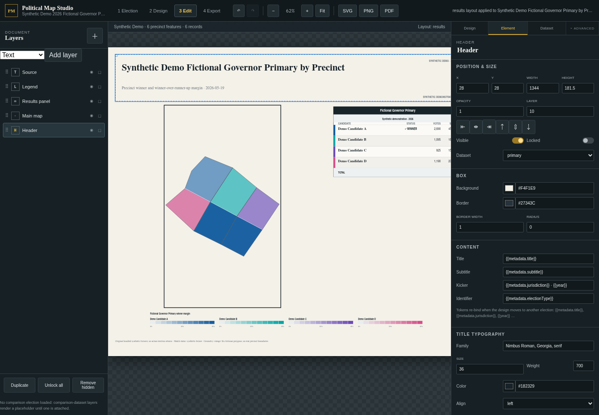

# Political Map Studio

A local vector map editor for election cartography, built with React, TypeScript,
FastAPI, and GeoPandas. Choose a matched dataset, reuse a design, edit the page,
and export SVG, PNG, or PDF. This public edition runs with six fictional precincts
and synthetic votes, so reviewers can try the workflow without private data files.



[View the exported sample map](docs/demo.png)

## What this demonstrates

- Geographic joins with explicit keys, CRS handling, diagnostics, and source hashes.
- Reusable designs separated from matched election data and self-contained projects.
- SVG map rendering, layers, insets, candidate colors, legends, and comparison views.
- Undo/redo and IndexedDB autosave that separates large datasets from layout edits.
- Shared browser/CLI rendering and CairoSVG conversion to PNG and PDF.
- Preservation of unmapped votes in totals and reconciliation diagnostics.

See the [election map portfolio](https://github.com/JacksonAHannan/election-map-portfolio)
for published work produced by the broader election analysis project.

## Run locally

Requires Node 20+, Python 3.11+, uv, and system Cairo libraries. On Linux,
install the Cairo runtime through your distribution package manager.

```bash
npm ci
uv sync --extra test
npm run build
uv run python -m uvicorn political_map_studio.app:app --host 127.0.0.1 --port 8000
```

Open http://127.0.0.1:8000 and select **Synthetic Demo** from the library.
For development, run the backend and `npm run dev` in separate terminals;
the Vite interface opens at http://127.0.0.1:4173.

The synthetic sample is not a real election or actual precinct geography. The
fixture's candidate keys are retained for compatibility with the existing examples.
The library presents them as Demo Candidates A–D.

## Export and verify

```bash
npm test
uv run --extra test python -m pytest tests/backend -q
uv run political-map render-template public/templates/alabama_editorial.json \
  --results sample-data/results-wide.csv \
  --geography sample-data/precincts.geojson \
  --metadata sample-data/election.json \
  --output output/example.png
```

Create `output/` before running the export command. SVG is the canonical renderer
output; PNG and PDF conversion use it directly. Font availability affects output.

Three integration tests require the original election archive and skip when its
catalog and inputs are absent. All self-contained model, renderer, import,
reconciliation, cache, and API tests run with bundled or temporary fixtures.

## Working with actual elections

Import your own authorized GeoJSON, GeoPackage, or zipped Shapefile and CSV under
**Advanced → GIS import**, or register a pre-matched pair in `library/catalog.json`.
Source paths default to this repository; set `ELECTION_MAPS_ROOT` to an external
archive root when using the [reference archive catalog](docs/archive-catalog.json).
The real catalog is metadata only; its source datasets are not distributed here.

The [archive workflow](docs/ARCHIVE_WORKFLOW.md) records the original application
and its ten-election library. Paths in that document describe the original archive.
[Project schema](docs/PROJECT_SCHEMA.md) and [roadmap](ROADMAP.md) cover the format
and current limitations. The renderer supports winner and winner-by-margin encodings;
not every proposed roadmap feature is implemented.

## Publication boundary

This is a curated source snapshot of the original Election-Maps subproject. It
excludes real election datasets, generated caches, local state, environments,
and dependency directories. MIT applies to project code and original synthetic
fixtures; it does not grant rights to external source data or fonts.
